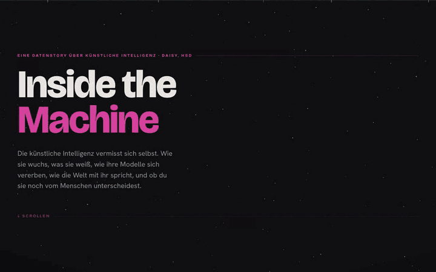

# Inside the Machine

An interactive scrollytelling data story in which AI measures itself: how compute grew, what
research it produced, how models inherit from each other, how people talk to it, and whether a
reader can still tell it apart from a human.

**Live demo:** <https://inside-the-machine-two.vercel.app> · Short paper (German): [`paper/short-paper.pdf`](paper/short-paper.pdf)



Final project for the course Visual Analytics, B.Sc. Data Science, AI and Intelligent Systems
at Hochschule Düsseldorf, summer 2026. Single-author work. The interface and the paper are in
German.

## The five acts

| Act | Question | Data | Visualization |
|---|---|---|---|
| 1 Compute | How fast did training compute grow? | 466 models from Epoch AI | scatter over time on a log FLOP axis with a frontier line |
| 2 Research | What does AI research work on? | 477,807 arXiv papers, citations from OpenAlex | canvas point cloud (TF-IDF + truncated SVD), year scrubbing, click a field for its most cited papers |
| 3 Model families | How do models descend from each other? | 528,311 declared `base_model` links on Hugging Face | zoomable galaxy of 160 family hubs and 38,385 child models |
| 4 Use | What do people ask AI for, country by country? | 837,989 WildChat conversations | reorderable matrix of 53 countries; sorting is the analysis |
| 5 Judgement | Can you still spot the machine? | HC3 answer pairs, real and generated images | twelve-round quiz, results split by text and image |

Act 4 ends with a refutation: the correlation between role-play and borderline content drops
from r = 0.71 to r = 0.24 once two data-determined leverage points are removed.

## How it was built

I worked AI-first. I set the guiding question, picked and checked the datasets, designed the
five-act story, chose the encodings with the course literature (Munzner, Cleveland and McGill,
Tufte, Ware, Segel and Heer, Yi et al.) and reviewed every iteration. Claude Code and Codex wrote
most of the code and the data pipelines under that direction. The full log, phase by phase, is
in [`docs/ki-nutzung.md`](docs/ki-nutzung.md) (German).

Evidence that it works, reproducible from this repository:

- 160 unit and component tests (Vitest), see below
- the topic heuristic for WildChat checked against 400 separately labelled prompts:
  κ = 0.50, accuracy 0.555, macro F1 0.53 ([`data/heuristik-validierung/`](data/heuristik-validierung/))
- keyboard path, reduced motion and screen reader tables, checked automatically and by hand
- measured frame rates in the paper: 51 fps for act 2, 38 fps for act 3

## Run it

Node.js 20 or newer:

```bash
cd app
npm ci
npm test          # 160 tests
npm run build
npm run preview   # http://localhost:4173
```

Browser checks with Playwright need a running preview server:

```bash
URL=http://localhost:4173 npm run e2e
URL=http://localhost:4173 node scripts/scrollsweep.mjs
```

## Rebuild the data

The raw data is about 6 GB and not part of the repository. The built JSON files the app uses
are in `app/public/data/`.

```bash
python3 -m venv .venv
.venv/bin/python -m pip install duckdb numpy scikit-learn huggingface_hub pytest
.venv/bin/python data/pipelines/pull_all.py
.venv/bin/python data/pipelines/fetch_arxiv_oai.py
.venv/bin/python data/pipelines/fetch_top_papers.py
.venv/bin/python data/pipelines/build_epoch.py
.venv/bin/python data/pipelines/build_map.py
.venv/bin/python data/pipelines/build_familytree.py
.venv/bin/python data/pipelines/build_wildchat.py
.venv/bin/python data/pipelines/build_spot.py
.venv/bin/python data/pipelines/redact_public.py app/public/data/wildchat.json
```

`OPEN_DATA_CONTACT` (arXiv user agent) and `OPENALEX_MAILTO` (OpenAlex polite pool) can be set
as environment variables.

## Differences from the graded submission

- Two WildChat example texts are removed by `data/pipelines/redact_public.py`: one with a
  person's name, one with a personal booking link. The app now shows 846 instead of 848
  example conversations; all aggregates are unchanged. The tests were updated to the new
  counts, and one label that had the total hardcoded now reads it from the data.
- The three real photos in the act 5 quiz are replaced by CC0 photos from Wikimedia Commons with
  the same motifs (café, library, platform). The submission used photos from
  Parveshiiii/AI-vs-Real, which most likely come from Flickr via COCO; their rights are not
  documented, and one showed an identifiable person.
- The fonts are bundled with the app instead of loaded from Google Fonts, so the page makes no
  requests to third parties.
- The pipelines write to `app/public/data/` in this layout.
- The paper refers to `supplemental/`; the AI usage log from there is in `docs/`. The
  project diary and the early data exploration notes are internal working documents and not
  part of this repository.

## Data sources and licenses

Source, license, retrieval date and every transformation per dataset are documented in
[`data/QUELLEN.md`](data/QUELLEN.md) (German). In short: Epoch AI (CC BY 4.0), arXiv metadata
via OAI-PMH, OpenAlex (CC0), Hugging Face model cards (no license on the dataset card),
allenai/WildChat-1M (ODC-BY), Hello-SimpleAI/HC3 (CC BY-SA 4.0, so `app/public/data/spot.json`
stays CC BY-SA 4.0), three photos from Wikimedia Commons (CC0), Natural Earth (public domain).

WildChat contains real user prompts. AI2 scrubbed the dataset of personal data, the pipeline
shortens every link to its domain, and texts above the moderation threshold are only shown
after an explicit click, with their score.

## Layout

```
app/        React 18 + Vite app, Canvas/SVG visualizations, tests, browser scripts
data/       Python + DuckDB pipelines, source documentation, heuristic validation
paper/      short paper (Markdown source and PDF)
docs/       design system and AI usage log
```

## License

Code: MIT, see [`LICENSE`](LICENSE). Data files keep the license of their source, see above.
